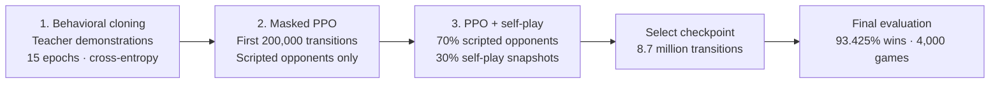
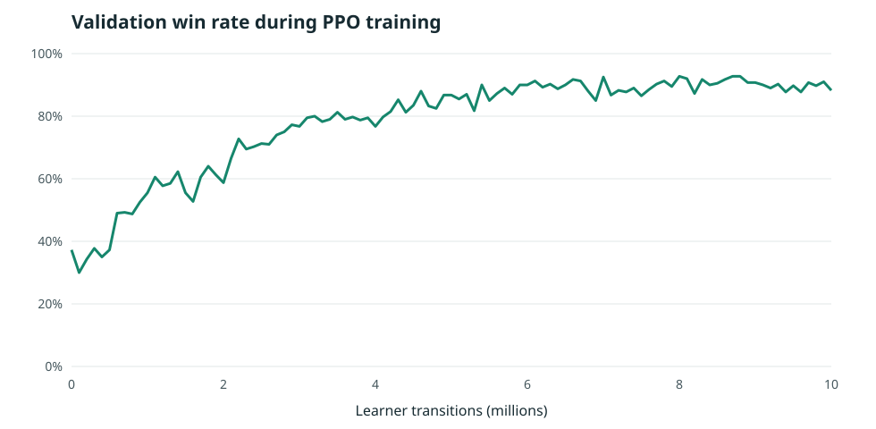

# Battlesnake

## Gameplay

[Watch the 2:12 gameplay demo: PPO vs Teacher](assets/demo.mp4) (silent video).

Read [report.pdf](report.pdf) first.

## Training pipeline



The league is part of the same PPO training run: the first 200,000 transitions
use scripted opponents, and self-play is enabled after that. Once snapshots are
available, the configured mix is 70% scripted
opponents, 15% sampled past snapshots, and 15% the latest snapshot. If a
snapshot is unavailable, its share falls back to scripted opponents.

### 1. Behavioral cloning

The policy learns to predict the Teacher's actions with cross-entropy loss,
using 150,000 demonstrated states from 1,654 games. Training runs for 15 epochs;
validation loss falls from 0.6009 to 0.1961. The BC-only policy wins 37.25%
of 400 validation games against the four evaluation opponents.

### 2. Masked PPO

Starting from the cloned policy, masked Proximal Policy Optimization improves
the policy through interaction with the game. In the first 200,000 learner
transitions, it trains against scripted opponents only; its validation win rate
at 200,000 transitions is 34.25%. The complete run uses 16 environments,
256 rollout steps, batch size 256, four update
epochs, learning rate 0.0001, discount factor 0.995, GAE lambda 0.95, clip
0.15, and entropy coefficient 0.01.

### 3. Scripted opponents and self-play

The scripted pool consists of **Teacher**, **Heuristic**, **Teacher Cautious**,
**Flood Hungry**, and **Greedy Food**, sampled with respective weights of
30%, 30%, 20%, 10%, and 10% within the scripted share. The remaining 30% of
the configured league mix uses saved versions of the learned policy.

At 1 million total transitions, validation win rate reaches 55.5%. The recorded
run continues to 10 million total transitions. The checkpoint selected at 8.7
million transitions wins **93.425%** of 4,000 final games (95% confidence
interval: 92.675%–94.175%).



The chart shows periodic validation win rates against Teacher, Heuristic,
Teacher Cautious, and Flood Hungry, with 400 games per evaluation. Final
evaluation is separate: 1,000 games per opponent, using the selected checkpoint.

| Final opponent | Win rate |
| --- | ---: |
| Teacher | 95.1% |
| Heuristic | 92.8% |
| Teacher Cautious | 92.6% |
| Flood Hungry | 93.2% |

The experiment used one training seed; cross-seed reproducibility has not been
verified. Full recorded configuration and results are in [docs/results.json](docs/results.json).

## Requirements

- Git
- Python 3.12
- Go 1.24.2, available on `PATH`

## Clone the repository

```sh
git clone https://github.com/bhdn-BB/Deep-RL-KPI.git
cd Deep-RL-KPI
```

## Install dependencies

```sh
python -m pip install uv==0.11.8
uv python install 3.12
uv sync --locked --project training --python 3.12
```

`uv` creates the virtual environment and installs the pinned dependencies.
Manual activation is not required for the commands below.

## Build the game engine

Windows PowerShell:

```powershell
go -C env/engine build -mod=readonly -o adapter.exe .
```

Linux/macOS:

```sh
go -C env/engine build -mod=readonly -o adapter .
```

## Start the web app

Run from the repository root:

```sh
uv run --locked --project training python -m webapp.server
```

Open **http://127.0.0.1:8080** in your browser. Use arrow keys or WASD to play.
Press `Ctrl+C` in the terminal to stop the app.

Trained weights are not included in the repository. Without weights, select the
scripted Teacher opponent. To play against a trained model, place its `.ts` file
and matching `.json` manifest under `runs/duel_v3/`, then refresh the model list.
